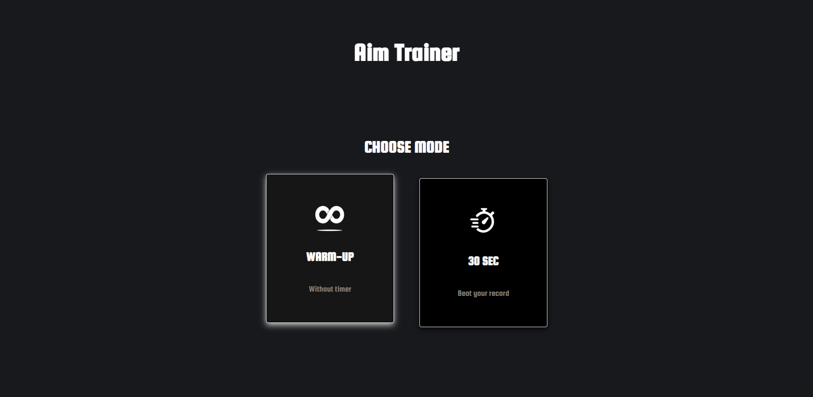
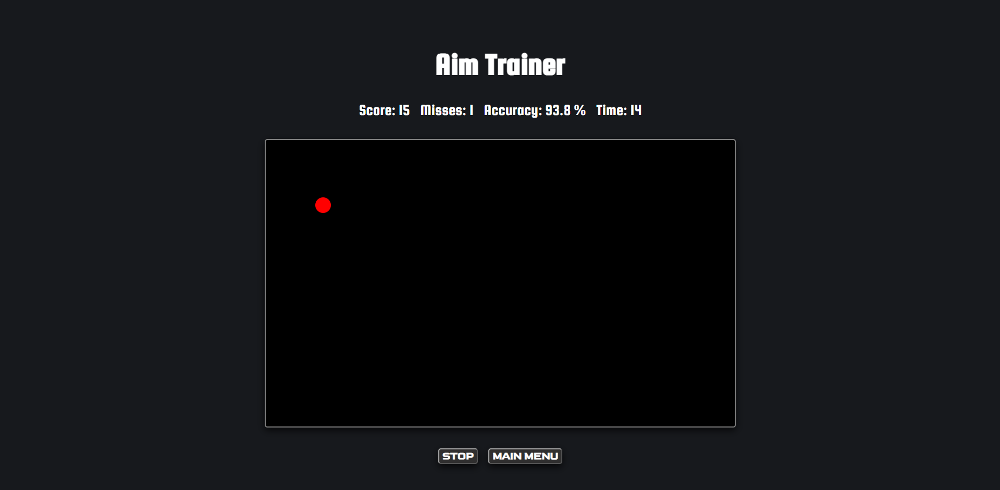
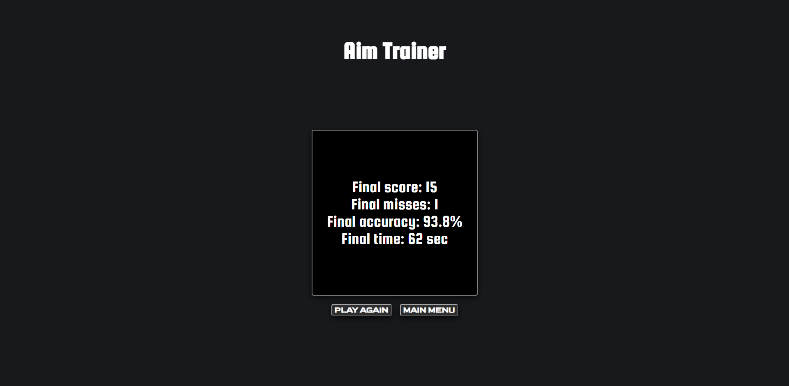

# Aim Trainer

A simple browser-based aim training game built with HTML, CSS and vanilla JavaScript.

Practice your aiming skills, track your accuracy and challenge yourself to get the highest score.

## Features

- **Infinity Mode** - practice without a time limit.
- **Timer Mode** - hit as many targets as possible in 30 seconds.
- **Score Tracking** - keep track of successful hits.
- **Miss Tracking** - count missed shots.
- **Accuracy Tracking** - calculate your shooting accuracy.
- **Live Timer** - track your session time.
- **Results Screen** - review your performance after each session.
- **Interactive UI** - custom styling, animations and screen transitions.

## Built With

- HTML5
- CSS3
- JavaScript (Vanilla)

## Getting Started

1. Clone this repository:

```bash
git clone https://github.com/soursnap/aim-trainer.git
```

2. Open the project folder.
3. Open index.html in your browser.

No additional dependencies or installation required.

## Project Structure

```
aim-trainer/
├── index.html
├── css/
│   └── style.css
├── js/
│   └── script.js
├── fonts/
├── images/
├── screenshots/
└── README.md
```

## Screenshots

### Main Menu


### Gameplay


### Results

